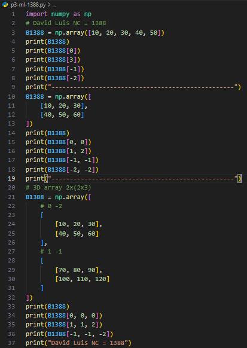
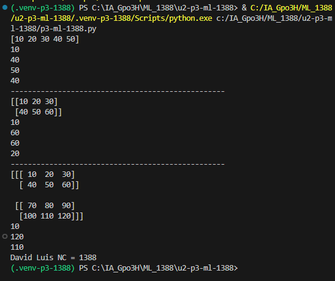

## Codigo

## Resultado

<div align="center">

# 🐍 Indexación en NumPy (1D, 2D y 3D)


Acceso a elementos mediante índices positivos y negativos.

</div>

---

## 📌 Resumen de Indexación

| Dimensión | Arreglo | Ejemplo | Resultado |
| :--- | :--- | :--- | :--- |
| **1D** | `[10, 20, 30, 40, 50]` | `n[0]`, `n[-1]` | `10`, `50` |
| **2D** | Matriz $2 \times 3$ | `n[1, 2]`, `n[-1, -1]` | `60`, `60` |
| **3D** | $2 \times (2 \times 3)$ | `n[1, 1, 2]`, `n[-1, -1, -2]` | `120`, `110` |

---

## 💻 Código del Proyecto

```python
import numpy as np

# 1D y 2D
n = np.array([10, 20, 30, 40, 50])
print(n[0], n[3], n[-1], n[-2])

n = np.array([[10, 20, 30], [40, 50, 60]])
print(n[0, 0], n[1, 2], n[-1, -1], n[-2, -2])

# 3D
n = np.array([
    [[10, 20, 30], [40, 50, 60]],
    [[70, 80, 90], [100, 110, 120]]
])
print(n[0, 0, 0], n[1, 1, 2], n[-1, -1, -2])